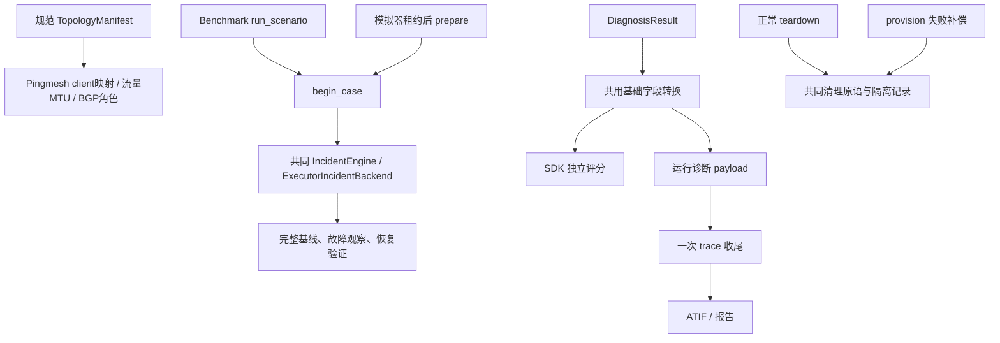

本轮以 `.netopsbench/refactor-round2-before/` 的工作区快照为基线，包含上一轮
成果和操作者已有未提交改动。公开 SDK、CLI、工具 schema、示例及扩展能力保留；
内部辅助方法和测试替身随新的内部约定迁移。故障分类、评分与冻结 campaign 不变。

## 如何判断可删除

核对 Python 导入、SDK 懒加载映射、CLI entry points、示例、验收脚本、故障注册表，
并追踪 `read_text` 后送入容器执行的资源。静态入口图最初未到达的四个模块均有
实际职责：`_bgpd_restore`、`_routing_probe`、`_sonic_probe` 在容器内执行，
`build_tools` 是文档公开的工具链安装入口。它们全部保留。

没有发现可以仅凭本次证据整包删除的大块代码。精简针对已确认的重复行为及
构造器不变量排除的分支。低覆盖率、没有直接 import、仅测试引用，均不单独
作为删除公开功能的依据。静态可达性分析不能证明所有异常组合都已真实执行。

## 逐模块处理

| 模块 | 检查结果与处理 |
|---|---|
| models / topology | 规范 manifest 已统一设备列表、角色与有效 MTU；保留 Clos/Fat-tree 构建、公开拓扑投影和配置渲染 |
| toolkit | BGP 角色直接取 manifest.switches；删除分组字典的旧形态分支；保留 SONiC/Linux、接口别名、历史查询和实时 fallback |
| pingmesh | client→leaf 映射直接取 manifest；删除先投影成 agent 拓扑再解析回内部映射的路径；覆盖、ingestion 与异常分析仍各有职责 |
| traffic | 删除旧拓扑字段逐级推断 MTU；共用带宽单位解析，估算仍为浮点数、下发仍为整数；规划、限速、控制事务和客户端就绪验证保留 |
| scenario | 新增一次 begin_case 初始化，两个入口共用；明确初始化案例字段，删除对这些必备成员的 getattr 回退；基线身份、窗口与恢复审计保留 |
| incident / simulator | StepResult 继承共同 transition 字段，保留公开名称、必填 flags、冻结和序列化语义；保留 reset/step、prepare/session 和 terminate_protocol 能力 |
| runtime | 正常销毁与部署补偿共用目录清理和隔离记录；生命周期阶段、bucket 所有权与重试规则继续由各入口明确选择 |
| session | 成功/失败诊断统一 trace 收尾；ATIF 的复制上下文去重只保留一个算法；保留无 recorder 的 tool_calls fallback、失败报告和 Harbor 导出 |
| evaluator / SDK | 共用 DiagnosisResult 基础字段转换，显式保留入口优先级；删除丢弃的 ground-truth index 参数及无职责结果转发；已归一化 evaluator 报告不再二次归一化 |
| agents | AgentHandle、同步/异步诊断及 recorder 是公开扩展链路；保留，不用单一内置 agent 的调用方式裁剪 |
| faults | 注册表、FaultSpec/FaultPack、ActiveFault、周期任务控制与补偿均有调用；保留直接注入和扩展回调，不合并不同故障机制 |
| observability | BGP 采集、事件索引、spool 与确认后删除是不同职责；保留完整数据链路；BGP 两种查询来源仅共用事件分类及输出 |
| client_agent | native 流量/探针进程及控制接口实际部署到设备，保留协议和资源 |
| CLI / scripts / utils | 正式命令、独立验收、工具链安装和容器内脚本保留；取消保护、deadline、计时与路径处理不是死代码 |

## 具体删除与合并依据

| 候选 | 调用链 / 不变量 | 结果与验证 |
|---|---|---|
| BGP 旧设备分组解析 | AgentToolkit 构造器已校验 manifest，内部设备是规范列表 | 改读 manifest；公开 BGP 查询测试及旧实现输出对照 |
| Pingmesh 私有拓扑重解析器 | 仅构造器从 manifest 投影后调用 | 删除 helper；通过真实构造器验证 Clos/Fat-tree 的 attached_switch 映射 |
| MTU 多字段 fallback | traffic 入口先校验 manifest，defaults.link_mtu 必为正数 | 直接取规范值；流量生成与限速测试 |
| 两个带宽解析器 | estimator 与控制器均解释 K/M/G 单位 | 共用解析；调用端保留空值处理及整数转换，不放宽无效下发参数 |
| 两份案例重置 | run_scenario 与 RuntimeEpisodeBackend.prepare 各自重置同类字段 | 调用 begin_case；清空案例证据，保留流量与已验证基线对象 |
| StepResult 字段复制 | 与 SessionTransition 字段相同，只有 valid/case_valid 必填性不同 | 继承字段并显式重声明两个必填项；schema、序列化及 frozen 测试 |
| 两份 trace 写入及引用回填 | 同一个回调的成功/失败分支使用相同落盘参数 | 只保留一次写入，失败信息在进入收尾前构造；已有 tracing/失败报告测试 |
| 两份复制上下文去重 | recorder 规范化与 ATIF 输出重复同一去重状态机 | 共用算法；保持原始 index、上下文顺序及运行事件后的过滤规则 |
| BGP 重复分类与 collection_gap 输出 | fast/snapshot 的时间线不同，分类和字段语义一致 | 保留来源解析；共用输出，5832 组旧/新输出逐项相等 |
| 多处清理错误记录与目录删除 | 正常销毁和补偿都需要验证目录消失并保留隔离状态 | 共用原语；正常销毁按所属 bucket 清理，provision 仅清理本事务创建的 bucket |
| SDK index 与报告转发 | 单 episode ground-truth 不使用 index；registry 返回的 adapter 已返回 BenchmarkReport | 删除内部无效参数和二次归一化；公开 testcase ID、接口和扩展 evaluator 形式不变 |

仍保留的薄封装有明确用途：SDK 稳定入口、故障注册回调、可替换的观察操作、
带取消检查/审计/计时的操作方法。没有用动态方法生成或通用大基类替代显式实现。

## 统一后的执行关系

诊断入口差异显式保留：SDK 已有 location 时不补平铺字段，runtime 按字段补全；
SDK 可以读取 metadata.evidence 和 findings.tool_calls，runtime 保留其原优先级。
runtime 耗时取实际计时，SDK 独立评估使用传入 metadata 耗时。缺失诊断仍为
inconclusive，已有有效评分继续复用。

BGP 索引未覆盖窗口时仍查询完整快照；不同来源的状态时间线、前缀时间戳一致性
及样本数量计算没有合并成假定等价的数据。自定义非 catalog-v2 故障也继续保留。

## 单列的行为修复

正常 teardown 原来可能漏掉“deployment_started 已置位，但中断发生在阶段结果
写入前”的资源；现在将该状态视为已开始部署。清理抛错后即使隔离元数据写入
再次失败，也保留原始异常与内存中的隔离记录，不用持久化异常覆盖根因。
这些属于清理正确性修复，不作为纯等价重构描述。

目录清理统一先尝试本地删除，仍存在时才调用非交互 sudo；最终必须确认目录
消失。不同入口的 bucket 所有权规则不合并，避免补偿时删除非本事务资源。

## 验证与规模统计

最终完整离线回归：1252 项通过（274.63 秒）、8 项 real 测试不在离线执行，
2 条第三方 websockets 弃用警告。包含 BGP 双路径组合及已有测试 49 项，
以及显式 Clos / fat-tree-k8 映射及查询测试 12 项。新旧 BGP 输出对照 5832 组相等。
配置范围内 mypy 检查通过（84 个源文件）；Ruff、干净 wheel 契约和差异检查通过。

首轮完整回归的 7 项失败来自绕过构造器、缺少新内部成员的测试替身，已迁移
并复测。健康观测、私有证据隔离、恢复超时等原有断言保留，没有删去失败测试。
新增公开 StepResult 必填字段、冻结语义、诊断来源优先级、案例重置及清理中断测试。

真实验收：medium 的健康、loss、ECMP、route_flapping 及各自后续健康案例
共 7 例通过；XS 的健康、link_down、bgp_auth_mismatch 及各自后续健康案例
共 5 例通过。所有案例有效且恢复成功，专用 runtime 的容器、网络和目录均已移除。
真实 BGP 故障窗口的自动查询路径与强制完整快照回退均返回 spine1、leaf2 的
`session_down` 证据；自动路径未额外插桩，不据此断言它必然选择了快速索引。

| 范围 | 新增行 | 删除行 | 净变化 |
|---|---:|---:|---:|
| 核心 Python | 245 | 449 | -204 |
| 脚本及示例 Python | 0 | 0 | 0 |
| 测试 Python | 232 | 39 | +193 |
| 文档 | 127 | 1 | +126 |

统计相对本轮开始快照，包含注释和空行；不把上一轮改动或移动文件计算成删除
收益。核心代码没有搬到脚本/测试目录，核心净减少 204 行。此次收益是减少重复
行为的维护点，未声称有新的端到端性能提升。

逐文件差异统计与验证凭据位于 `.netopsbench/refactor-round2-verification/`；
真实案例记录位于 `.netopsbench/refactor-round2-medium/audit.json` 与
`.netopsbench/refactor-round2-xs/audit.json`。它们是本地运行产物，不作为源码提交。
