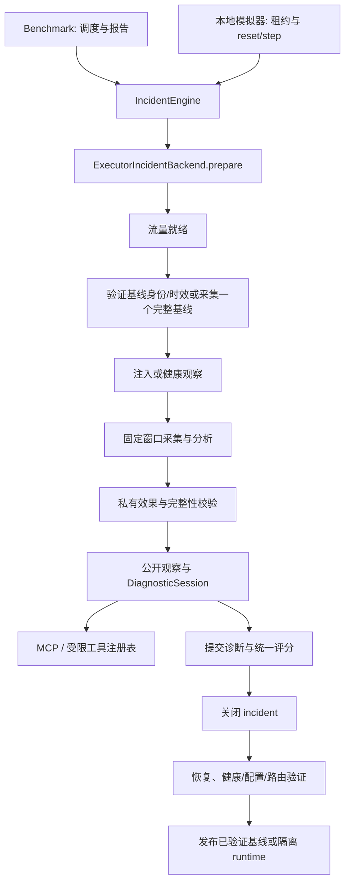

本次整理以当前工作区（包括既有未提交改动）为基线，保留本地 SDK、benchmark、
MCP、自定义 agent 和故障扩展。下面区分代码检查、离线验证和真实环境验证，
不将模拟测试结果视为真实故障效果。

## 执行链路与职责

RuntimePool 仍依次部署设备、配置观测、启动 native client-agent、检查健康。
Pingmesh 是观察路径；FaultInjector 是修改网络状态的路径。二者不相互替代。

模拟器不再维护第二套基线缓存，也不再用第二段采集窗口验证第一段基线。
两种入口共用流量、基线、注入、观测、效果和恢复实现。基线复用保留时效、
配置/实例/流量身份、单次消费、恢复发布和重新查询晚到数据的限制。
发现未恢复的 active fault 时拒绝准备新案例，由清理路径处理残留。

租约池只在锁内操作记录与容量，部署和销毁在锁外执行。预留容量计入上限；
部署补偿失败及销毁失败的记录继续占用容量且不可出租。drain 等待在途部署，
不会遗漏刚完成的资源。incident 关闭还会等待已开始的工具调用结束，避免查询
与恢复同时访问正在变化的设备。

## 公开证据与私有实现

| 信息 | 处理 |
|---|---|
| 接口 admin/oper、MTU、地址、计数器 | 保留；支持接口别名过滤 |
| FRR 配置、RIB、kernel FIB、ACL 规则和计数 | 保留，是诊断对象的真实状态 |
| netem/qdisc 参数及实现名称 | 不在接口任何格式中返回；只保留在私有效果审计 |
| 注入目标、参数、机制、恢复日志、评分答案、内部路径字段 | 从公开结构中递归移除 |
| 工具执行/采集错误 | 公开失败标志和通用错误，不返回内部异常文本 |
| 拓扑自定义 metadata | 仅保留 pod、rack、client_subnet、site、edge_index、pod_index 的标量值 |
| 语义化 episode ID、worker 环境变量及本地路径 | 不进入自动构建的诊断 context |
| 原始执行和恢复失败 | 留在操作者持有的 incident/运行报告；交互返回使用通用错误 |

新增投影应用于 stdio MCP、会话后端和初始公开观察。它是结构化输出边界，
不是对同进程任意 Python 代码的安全沙箱。自定义本地 agent 是受信任代码；
不能依靠 SDK 对象封装阻止其读取宿主文件或反射私有对象。Codex 示例继续使用
独立容器和会话 MCP。正常设备配置/日志文本仍保留其诊断含义，不做关键词盲删。

接口工具的 raw 输出移除的是 ip-link 头部 qdisc 字段，不删除 MTU、状态或错误计数。
实时结果包含 `collected_at`；历史日志和接口指标使用 topology 身份及 episode 默认
时间范围，并返回 `time_scope`。实时 fallback 有单独采集时间，不充当历史样本。
周期故障可能在实时查询瞬间恢复，必须结合完整时间窗判断。

## 问题与修复清单

| 问题 | 修复及验证边界 |
|---|---|
| 工具通过 tc 参数或 ip-link 原始头部暴露注入实现 | 删除 include_tc；私有审计独立读取 qdisc；所有接口格式验证无实现标记 |
| interface 参数未真正过滤状态与地址 | 同时过滤 SONiC 表、Linux fallback 和地址；别名等价匹配；不存在的接口失败 |
| 清理抛错后再次访问未赋值 cleanup_result，掩盖根因 | 先保存失败结果，再清空基线并原样抛出；执行失败和清理失败分别记录 |
| 部署补偿失败或中断丢失资源所有权，可能错误释放容量 | 捕获中断并补偿；RuntimeProvisionError 分别携带原始/清理异常及 runtime；即使隔离元数据写入失败也保留资源，池禁止再次出租 |
| 慢部署/销毁占用租约条件锁 | 锁内预留与发布，锁外执行；同步事件测试验证续租、释放和容量约束 |
| 关闭 incident 与在途工具查询交错 | 关闭等待已开始的工具调用结束，锁内再次检查 ACTIVE |
| 模拟器独立基线签名与重复验证窗口 | 委托共同 backend；同一基线身份、单次消费、时效和恢复发布规则 |
| 历史指标/日志与当前案例窗口不一致 | 使用 episode 时间范围与 topology 过滤；实时 fallback 单独标注采集时间 |
| 接口指标 fallback 重复采集，工具 schema 反复构造 | 同一请求采集一次；缓存静态 TypeAdapter，不缓存跨注入边界的设备状态 |
| 无诊断结果被默认视为健康 | 缺失 verdict 默认 inconclusive；保留负样本原评分语义 |
| 有保存评分时仍重建 ground truth | 只有独立评分分支构造 ground truth；测试禁止复用路径访问拓扑或再次调用 evaluator |
| 服务采集异常和 ping 执行错误带出内部信息 | 按采集来源处理异常；保留 ping 丢包与本地 MTU 错误；公开状态不附加查询异常文本 |
| 删除源码后旧构建缓存仍将 HTTP 服务装入 wheel | 从干净副本执行 wheel 契约测试，检查模块与 console script 均不存在 |

## 故障证据矩阵

下表覆盖 catalog v2 的全部 24 类以及健康样本。生效检查是案例有效性判定，
公开证据是 agent 可查询的依据。恢复还要经过共同的健康、配置及路由验证。

| 类型 | 前置条件与修改 | 生效/公开证据 | 恢复依据及注意事项 |
|---|---|---|---|
| link_down | 可读且原本正常的链路端点；关闭接口 | admin-down、邻接和探针变化 | 恢复两端拥有的状态及路由；不覆盖预存 down 状态 |
| link_flapping | 正常链路；周期关闭/恢复 | 验证过的周期阶段（私有）、接口与 BGP/Pingmesh 时序（公开） | 停止周期任务后恢复；线程未退出不能报成功 |
| interface_ip_misconfig | admin-up 且 SONiC/live 地址一致；替换 IP | 实际地址变化、邻接/连通变化 | 保存并恢复原地址；避免先删最后一个地址 |
| device_down | 节点正常运行；Containerlab stop | 节点停止、邻居与路径影响 | start、停车 namespace/链路状态和健康验证 |
| bgp_process_down | bgpd 正在运行；停止服务 | 节点仍可达、bgpd STOPPED、BGP 缺失 | 恢复服务和捕获的原配置 |
| packet_loss | 可拥有的默认 qdisc；netem loss | 私有规则回读，公开实测丢包增量 | 删除自身 qdisc 并回读；不覆盖外部 qdisc |
| packet_corruption | 可拥有的默认 qdisc；netem corrupt | 私有规则回读，当前公开证据主要是丢包 | 同上；没有独立 CRC/payload 损坏观测 |
| high_latency | 可拥有的默认 qdisc；netem delay | 相对基线的实测 RTT 增量 | 删除并验证 qdisc；区分注入 delay 与实际 RTT |
| mtu_mismatch | 可读取原 MTU；降低接口 MTU | 实际 MTU、小包/DF 大包差异 | 恢复原 MTU 并回读；区分本地 probe 错误 |
| blackhole_route | 目标前缀可配置；加入丢弃路由 | 实际 RIB/FIB 的 discard 与通信影响 | 删除拥有的路由并验证 |
| static_route_misconfig | 目标存在可构造的错误下一跳 | 配置、FIB、路径和可达性 | 移除拥有的静态路由；补偿失败保留残留 |
| routing_loop | 存在可形成返回路径的邻居 | 两端 FIB 循环与真实 TTL 耗尽/重复跳点 | 撤回静态路由；不能只凭注入命令认定成环 |
| bgp_as_mismatch | 邻居原本 Established；改 remote-as | 配置、邻居状态/错误 | 恢复原邻居选项 |
| bgp_auth_mismatch | 邻居原本 Established；改认证 | 两端配置、会话状态和日志 | 恢复原认证选项 |
| bgp_update_source_mismatch | 邻居 Established、选择的源接口不存在 | update-source 配置与实际接口不符 | 恢复原选项；旧案例保留旧默认 |
| bgp_neighbor_shutdown | 邻居 Established；设置 shutdown | 配置与邻居状态 | 恢复原 shutdown 状态 |
| bgp_max_prefix_misconfig | 原接收前缀至少两个；降低阈值 | 阈值、前缀数及明确的 prefix-limit 错误 | 恢复阈值并重新建立会话 |
| route_origination_misconfig | 本地产生目标前缀；撤 network 或拒绝起源策略 | RIB、通告、FIB 变化 | 恢复 network/原策略，移除拥有的策略对象 |
| route_filter_misconfig | 邻居和前缀前置条件满足；import/export 策略 | 两端通告、策略、FIB 的缺失或下一跳减少 | 恢复原策略绑定并刷新路由 |
| route_flapping | BGP 会话正常；周期切换前缀策略 | 反复前缀撤回/通告，且会话保持 Established | 停止周期任务并恢复策略；不用 session flap 代替 |
| ecmp_misconfig | 实际 FIB 多下一跳；限制路径/关闭 relax | 候选 BGP 路径仍在、实际 FIB 下一跳减少 | 恢复策略与下一跳；RTT/loss 可以正常 |
| acl_source_misconfig | 指定接口、方向和源范围 | ACL 匹配、命中计数、受影响/对照通信 | 按拥有的规则身份删除 SONiC/iptables 状态 |
| acl_destination_misconfig | 指定接口、方向和目的范围 | 同上，核对目的前缀 | 同上，不清空其他 ACL |
| acl_l4_port_misconfig | 指定 UDP 目的端口及接口/方向 | UDP 受影响、规则命中，ICMP 对照 | 同上；ICMP 正常不能证明 UDP 健康 |
| none（健康） | 健康基线与完整采样 | 健康观测，仍调用 agent | 不注入；只有 network_healthy 获得负样本得分 |

corruption 与 loss 当前可能只产生相似的丢包症状。没有证明所有拓扑/路径下
均可可靠区分；本次不改变分类或评分，也不制造 CRC 计数填补证据缺口。
ECMP 案例检查转发冗余，不能用“Pingmesh 无异常”替代配置/路由健康。

## 精简与可达性依据

| 入口/组件 | 判定 | 处理 |
|---|---|---|
| pyproject CLI、SDK 懒加载、本地 SimulatorManager | 正式执行入口 | 保留并做打包/契约验证 |
| 独立 simulator_service / SimulatorService / HTTP 请求模型、事件日志和 tombstone | 用户明确移除的功能，不是误判为死代码 | 删除模块、console script、simulator extra 和专属测试 |
| authenticated session MCP 与公开 stdio MCP | 诊断 transport，仍被示例与 SDK 调用 | 保留 |
| 模拟器 baseline_signature、_ensure_baseline、重复流量准备与修复路径 | 由共享 backend 接替 | 删除，并将测试迁移至共享行为与两种入口一致性 |
| backend 的 setup_traffic=False / 外部 baseline_window 构造分支 | 原模拟器专用路径；移除调用者后仅测试引用 | 删除参数与分支，测试通过正式准备路径验证 |
| 接口 _get_device_interfaces 包装和重复格式分支 | 原 wrapper 负责 tc，职责消失 | 合并为一次采集与统一格式处理 |
| 两个接口指标 fallback 查询 helper | 同一请求各取一遍接口状态 | 改为纯列表选择函数，共享一次实时采集 |
| WorkerExecutionContext.as_env | 自动传入 context 的宿主路径通道；不再有正式调用者 | 移除；外部 stdio 配置由操作者显式提供 |
| FaultSpecRegistry、自定义 fault pack、动态 MCP 注册、SDK 导出 | 动态调用/扩展契约 | 保留，不以无直接 import 或低覆盖率删除 |
| Containerlab wrapper、SONiC startup、native client-agent、BGP helper、观测资源 | 子进程/打包资源路径 | 保留，并保留 wheel 资源测试 |
| 保存的 evaluation_result | 正式评分结果复用 | 保留；仅缺失时独立评估，缺失 verdict 默认为 inconclusive |

既有用户改动和未跟踪文件不纳入删除候选。旧服务测试的删除与功能移除对应；
基线、流量失败、隔离、重复 close 等仍由迁移后的本地测试覆盖。

## 迁移说明

- 删除独立 `netopsbench-simulator` 命令和 `netopsbench[simulator]` extra。
  改用 `bench.simulators.create()` / `prepare()`。诊断 HTTP MCP 不受此删除影响。
  已安装环境需重新安装新版包。发布 wheel 应使用干净源码目录，不能沿用旧
  `build/lib`：setuptools 增量构建可能把已删除文件继续装入 wheel。
  wheel 契约测试现在从临时源码副本构建，并断言服务模块与命令都不存在。
- `include_tc` 从直接 toolkit 和 MCP 签名删除。旧直接调用会得到 TypeError；
  删除该参数，使用正常接口证据。`interface` 现在真正过滤所有视图及地址。
- 公共结果增加采集时间；不要用整个结果字典等于固定常量判断工具成功。
  `get_device_interfaces(format="both")` 的 `structured` 统一为包含
  `device` 与 `interfaces` 的对象；原先 Linux/client fallback 可能直接返回列表。
- 自动生成的诊断 context 不再含 `worker_env` 和语义化 episode ID。
  使用 `context.tools`，或由操作者显式配置外部 MCP；不要从模型输入获取宿主路径。
- 自定义拓扑 metadata 只投影支持的标量字段；内部扩展数据仍可保存在 manifest。
- 默认参数收敛为 loss 30%、corruption 20%、latency 120ms、MTU 1400。
  直接 corruption 旧默认 5% 和 latency 旧默认 100ms 改变；需要旧值时显式传参。
- 新生成案例记录 `metadata.generator.version=3` 与 seed，错误 IP/Loopback
  值按 seed 变化。注入前检查地址冲突与接口是否已存在；已有场景文件不改写。
- 冻结 campaign 保留其源码快照、参数和评分。新工具边界与默认值应使用新运行记录。

## 性能与验收记录

新增私有阶段 `operations` 计数，记录平台命令入口的 subprocess/Docker 调用及
Influx 查询；健康检查、路由采集和部署线程传播计数上下文。恢复次数与 ingestion
重试另计。租约池记录获取总耗时、锁获取耗时和条件等待耗时。计数不含外部 LLM、
独立后台服务或绕过平台命令入口的第三方进程，不能当作整台主机的调用总数。
工具查询还按工具名累计耗时、调用数、失败数和操作数。父阶段包含子步骤，
不能将父阶段与子步骤计数相加。

`scripts/validate_runtime_refactor.py` 提供无 LLM 的固定工具序列，每个故障后
执行健康案例，失败立即停止并清理自己创建的 runtime。medium 使用 XS 实测
容量样本进行预检；运行保留内存紧急取消机制。`audit.json` 包含完整私有证据、
每次部署/案例耗时、Docker/Influx 调用数及清理状态。性能运行记录源码和脚本
摘要，使用相同 seed 与完整观测窗口。脚本输出的 inconclusive 不是诊断准确率。
计时范围是共享 ScenarioExecutor/DiagnosticSession 的确定性工具执行路径；
不包含外部 agent 容器、LLM 或 HTTP MCP transport 的启动开销。冷启动样本
包含新 runtime 部署及首次案例，复用样本在同一 runtime 上重新执行相同类型；
性能模式的工具序列根据公开拓扑遍历全部交换机，不读取私有注入目标。

在同一主机上，以本次改动前的工作区源码快照对比，工具参数校验预热后每次
执行 10,000 次，重复三次：

| 指标 | 改动前 | 改动后 |
|---|---|---|
| registry 参数校验，三次秒数 | 0.50294 / 0.50057 / 0.51075 | 0.04222 / 0.04262 / 0.04212 |
| 中位数 | 0.50294s | 0.04222s |
| 相同接口指标 fallback 的实时接口采集次数 | 2 | 1 |
| 模拟器首次基线的完整采集窗口数 | 2 | 1 |

约 11.9 倍的校验微基准改善来自缓存静态 TypeAdapter，不能外推为端到端加速。
基线窗口数和重复采集次数由行为测试验证；未降低完整窗口时长或故障校验要求。

最终离线完整回归通过 1207 项（8 项 real 测试不在离线套件执行），耗时
268.92 秒；另有 2 条第三方 websockets 弃用警告。中断清理等运行时聚焦测试
87 项通过。全项目配置的 mypy 检查通过（84 个源文件），Ruff 与
`git diff --check` 通过。原始离线日志保存在 `.netopsbench/refactor-verification/`。

真实环境已验证 Docker、镜像与固定 Containerlab 工具链。首次部署曾因 sudo
权限失败，取得操作者授权后，在专用新建 runtime 上完成 XS effects 验收：
健康、链路关闭、设备关闭、BGP 认证故障均有效、执行完成且恢复成功；最终
runtime 已销毁。记录：`.netopsbench/refactor-after-xs-20261104/acceptance.json`。
没有复用或改动其他正在运行的实验拓扑。

XS 固定工具调用验收也已通过：3 个故障分别跟随后续健康案例，共 7 例，
runtime 已销毁。记录：`.netopsbench/refactor-scripted-xs/audit.json`。

medium 固定工具验收已通过 17 例（8 个故障，各跟随健康案例，加初始健康），
包括 loss、corruption、latency、MTU、link_flapping、route_flapping、
acl_destination_misconfig 与 ecmp_misconfig。各例 case_valid/success 为 true，
恢复成功，最终 runtime 已销毁。这里每类选择一个生成实例，不代表该类所有
角色、方向与机制组合均已完成真实验收。记录：
`.netopsbench/refactor-scripted-medium/audit.json`。

真实中断验收通过：专用 XS 部署完成后主动抛出 KeyboardInterrupt，原始中断
被保留，所属容器、管理网络及 runtime 目录均已清理。记录：
`.netopsbench/refactor-cancel-real/acceptance.json`。首次 sudo 失败留下的本任务
隔离目录也已清理；最终核查没有本任务 audit 容器残留。

三次冷启动/复用性能对比已完成。前后各 30 个案例（含恢复后的健康检查）全部
有效且执行成功；前后各 9 个 runtime 均已销毁。每种类型各有 3 个冷启动与
3 个复用样本，冷启动包含部署和首次案例。两侧使用相同固定调用脚本。
另检查重构后 1500 份真实公开工具输出，未发现 netem/qdisc、fault_type、
effect_audit、recovery_journal 或本次内部路径标记；这项检查只针对公开输出，
私有 audit 本来就保留注入及恢复证据。

| 类型 / 模式 | 前三次秒数 | 后三次秒数 | 前 / 后中位数（秒） |
|---|---|---|---|
| 健康 冷启动 | 335.74 / 168.02 / 164.62 | 163.93 / 162.67 / 163.10 | 168.02 / 163.10 |
| 健康 复用 | 57.53 / 63.95 / 72.44 | 63.51 / 63.24 / 68.79 | 63.95 / 63.51 |
| loss 冷启动 | 195.78 / 201.50 / 196.60 | 208.67 / 209.01 / 196.53 | 196.60 / 208.67 |
| loss 复用 | 103.15 / 103.26 / 106.86 | 102.79 / 111.06 / 106.19 | 103.26 / 106.19 |
| ECMP 冷启动 | 202.91 / 203.45 / 203.55 | 202.64 / 203.48 / 205.88 | 203.45 / 203.48 |
| ECMP 复用 | 103.65 / 113.07 / 107.63 | 101.20 / 106.75 / 107.89 | 107.63 / 106.75 |

| 类型 / 模式 | Docker 命令数：前三次 → 后三次 | Influx 查询数：前三次 → 后三次 |
|---|---|---|
| 健康 冷启动 | 256/301/302 → 305/300/303 | 29/15/15 → 28/15/15 |
| 健康 复用 | 138/138/138 → 138/138/138 | 11/6/6 → 10/5/6 |
| loss 冷启动 | 318/316/316 → 315/310/315 | 15/15/15 → 15/15/15 |
| loss 复用 | 152/152/152 → 152/152/152 | 6/6/6 → 6/6/6 |
| ECMP 冷启动 | 320/321/317 → 318/321/319 | 15/15/15 → 15/15/15 |
| ECMP 复用 | 156/156/156 → 156/156/156 | 6/6/6 → 6/6/6 |

以 loss 复用样本为例，各阶段中位数如下；阶段可能包含子阶段，不能再次相加。

| 阶段 | 前 / 后（秒） |
|---|---|
| 基线采集（复用已验证窗口） | 0.00 / 0.00 |
| 注入 | 0.27 / 0.28 |
| 观察 | 30.00 / 30.00 |
| 观察查询 | 7.30 / 7.56 |
| 固定工具诊断 | 21.02 / 21.82 |
| 恢复与验证 | 44.75 / 45.62 |

端到端没有一致加速：loss 冷启动中位数增加，ECMP 冷启动基本持平；复用案例
的 Docker 命令数不变。窗口、采样率和校验没有缩减。剩余明显开销包括逐设备
接口/ACL 查询、完整观察及恢复窗口和遥测晚到等待；这些数据是后续优化依据，
不将本次微基准收益外推为整轮收益。

完整私有记录：`.netopsbench/refactor-perf-before/audit.json`、
`.netopsbench/refactor-perf-after/audit.json`；精简汇总：
`.netopsbench/refactor-performance-summary.json`。
实测源码保存在 `.netopsbench/refactor-source-before.tar.gz` 与
`.netopsbench/refactor-source-after-profiled.tar.gz`（不含固定工具链二进制）。
源码摘要和相同的 driver SHA-256 随记录保存。实测完成后补充的 provision
中断清理修复不在性能执行链路中：测量脚本使用 create + 显式部署阶段。

计时限制：主机保留其他既有实验；首轮重构前采样部分时间与本次离线回归
重叠。记录原始三次值及中位数，不据此声称受控实验中的因果加速；后续采样
不再并行运行本次测试。冷启动指新建 runtime，镜像预先存在，不清空 Docker 缓存。
