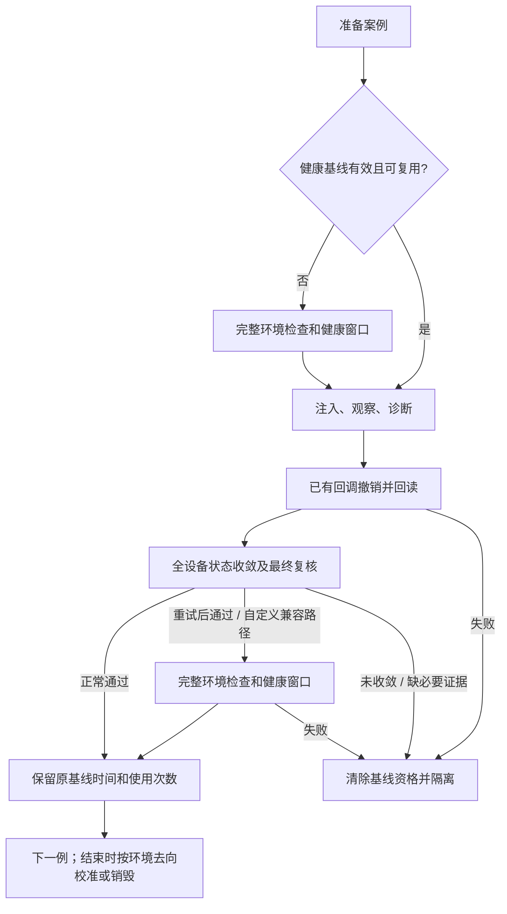

## 行为边界

新生成的 campaign 和 SDK 新建场景显式记录 `metadata.recovery_policy`。
`state_checked` 每例验证修改撤销、容器、接口、BGP、FIB、流量与基础连通；
它不表示每例完成了全网 Pingmesh 数据面验证。故障观察窗口、采样率、诊断工具
和评分不变。恢复策略 v3 只保留这一条执行流程；旧模式及其固定等待已移除。
旧场景必须显式迁移后执行，历史报告仍可读取。

没有引入逐 case 的恢复计划、新探针、client-agent 协议或 Batfish。



## 配置及迁移

```python
from netopsbench.sdk import NetOpsBench, RecoveryPolicy

bench = NetOpsBench(workspace=".")
case = bench.scenarios.create(
    id="healthy", name="healthy", scale="medium",
    episode={"episode_id": "diagnosis", "fault_type": "none", "duration_seconds": 30},
    metadata={"negative_sample": True},
    recovery_policy=RecoveryPolicy(
        baseline_max_cases=10,
    ),
)
```

新生成场景默认使用版本 3（10 次消费，无年龄上限）。不再提供 `--recovery-mode`。
旧版本或没有恢复策略的场景会在部署前报错；显式迁移到新目录：

```bash
netopsbench scenario migrate scenarios/generated/medium --out scenarios/migrated/medium-v3
netopsbench scenario validate scenarios/migrated/medium-v3/CASE.yaml
```

迁移保留 testcase ID、故障参数及 experiment 配置，记录源文件和场景摘要，
写入新的 campaign 身份及 `migration.json`，不覆盖原文件或既有输出目录。
冻结 campaign 不做原地升级。SDK `RecoveryPolicy` 保留名称，但不接受 `mode` 或 `baseline_max_age_seconds` 参数。
生成 spec 的 `recovery_policy` 仅接受 `version: 3` 和 `baseline_max_cases`；未指定的新建配置使用默认值。

## 每例检查与失败处理

故障恢复回调仍是 `FaultSpec.recover_active_fault`。内置回调返回的私有
`readback_verified` 标记只在实际回读通过时为真；没有相同保证的历史/自定义
回调进入完整验证兼容路径，不声称取得同等修改回读保证。

| 资源 | 实际回读 |
|---|---|
| 链路 | 两端管理状态、客户端原路由；周期任务退出后再恢复 |
| IP | 原地址集合、错误地址消失及对应 SONiC CONFIG_DB |
| MTU | 实际接口 MTU |
| qdisc | 拥有的 netem 已消失；不可拥有的原规则在注入前拒绝 |
| ACL | 原 iptables 规则完整恢复，拥有的 CONFIG_DB 对象消失 |
| FRR | 注入前/恢复后的规范化 running-config 摘要一致 |
| 静态/丢弃路由 | 配置及实际路由回读，并与案例前 FIB 核对 |
| bgpd / 设备 | 进程或容器运行、原配置恢复、相关网络状态收敛 |

命令返回零不能替代回读。失败项保留在活动故障表，不能由普通 ping 成功覆盖。

每例使用共享健康检查的状态部分：检查准确的容器身份；全部路由设备的接口、
邻接身份和 FIB；客户端 Pingmesh 状态；背景流量及基础跨机架连通。
首轮失败时只重采未收敛设备，之后必须完成两次全设备网络状态通过的采集，
间隔现有健康轮询周期（5 秒）。采集并发沿用现有限额。

全套遥测验收（包括发送 syslog 标记并等待入库）仅在完整校准运行。
不再先固定等待 post_recovery_wait，再开始状态查询。
恢复总 deadline 包含撤销、回读、收敛和异常校准，不为回退重新计时。

严格的重试策略意味着：即使最后恢复正常，只要状态检查曾出现错误或恢复发生
重试，就升级完整校准。链路或 BGP 案例可能因此仍等待完整窗口；不保证所有案例
都提速。明确的配置、FIB残留或任务未退出不能被完整 Pingmesh 覆盖。

## 基线和校准

每个 runtime 的原始健康窗口最多用于 10 个案例，不因经过 600 秒而失效；开始使用时计数，
诊断失败不退还次数。状态恢复成功只恢复复用资格，不延长窗口时间。
只有新的、完整验证过的窗口才能刷新基线。

首次、次数用满、流量或环境身份变化时，在注入前校准。身份变化后不拿旧
环境的窗口作新环境的比较基线。不缓存可能漏掉晚到记录的遥测查询结果。

平台拥有且确定立即销毁的 runtime 跳过末尾校准，记录 `runtime_will_be_destroyed`，
销毁失败仍标记清理失败。保留、外部或去向未知的 runtime 执行末尾校准；
紧邻结束的有效完整校准可以复用。校准失败将
worker 隔离并使运行失败，案例原始评分保留。结果写入独立的
`raw/<worker>/final_calibration.json` 和 worker summary。

模拟器每次 prepare 都重新获取租约；新的使用方开始前清除跨租约复用资格并
完整校准。案例关闭执行恢复，新模式不将未重新校准的环境直接证明为新租约健康。

## 报告及验证

私有 cleanup 包含策略、`validation_level`、完整验证原因、状态采集时间、轮询
次数及基线交接结果。案例准备记录基线窗口、年龄和使用次数；校准分别记录
环境检查、窗口等待和查询耗时及命令/查询计数。信息不进入 agent 上下文。
同一案例发生多次校准时分别记录 `calibration`、`calibration_2` 等阶段，避免
异常回退覆盖首次校准记录。恢复中的校准耗时已包含在 recovery 总耗时中，
统计总耗时时不要重复相加。

验收脚本 `scripts/validate_runtime_refactor.py` 支持：

- `--shadow`：恢复通过后额外完整校准，影子耗时独立记录，不更新正式基线和校准状态。
- `--all-mechanisms` / `--all-cases`：子机制或全部生成位置覆盖。
- `--readback-negatives`：仅抑制撤销写操作，仍从真实设备读取状态，检查不能错误放行；随后解除抑制执行正常恢复。
- `--tool-profile minimal`：只调用拓扑与 Pingmesh 汇总，排除模型耗时；两个版本必须使用相同 profile。
- `--batch-repeats 3 --sequence-repeats 2`：在三个独立 runtime 上重复整批序列，包含首次、周期和末尾校准；不与逐类型 `--repeats` 混用。
- `--compact-sequence`：性能运行使用健康样本和选定故障的连续序列；正确性验收仍独立执行影子检查。

计数范围为宿主 Python 发出的 Docker CLI 和 Influx 查询；不包括 Containerlab
内部子调用或容器内后台采集器的请求。两模式使用相同计数方式，部署和案例阶段
分别统计。整批耗时以实际起止时间测量，包含周期和末尾校准。

真实验收和完整序列性能记录保存在 `.netopsbench/state-recovery-*`；它们是本地
产物，不作为源码提交。

历史 v2 的删除依据与验收见 [Recovery v2 audit](./recovery-v2-audit)。

## v3 的兼容性与验证边界

v2 的 600 秒年龄限制已删除，agent 诊断超时与恢复 deadline 不变。
v2（包括省略年龄字段的 v2）必须显式迁移，不能通过忽略旧字段改变原 campaign。
迁移使用 v3 默认 10 次消费策略，保留故障参数与 testcase ID，生成新的身份；
原场景和历史报告无需原地修改。运行中的实验应继续使用冻结源码和配置。

校准后仍保留真实窗口起止时间、年龄和消费次数；每次查询仍读取该真实时间段，
状态检查不产生新的数据面窗口，也不刷新时间戳。长时间批次的基线可能跨越一小时以上，
因此 v3 不保证与 v2 相同的完整数据面证据新鲜度。若历史遥测因保留策略而不可用，
仍按原完整性校验处理，不能用空结果认定健康。

离线覆盖长时间复用、第 10/11 次、环境变化和恢复失败；v3 的真实影子窗口对照
及端到端性能尚待独立验收。下面的 v1/v2 实测不能视作 v3 的实测结果。

## 历史验收：bf09430（2026-11-04）

以下数据属于 v1 提交 bf09430，不能作为 v2 的验收结果。

### 离线验收

最终代码执行 `python -m pytest -q -m 'not real'`：**1272 通过，8 项 real 测试
未纳入该次离线执行**，耗时 278.96 秒；包含干净 wheel 安装后的入口验证。
另有 2 条既有 websockets 依赖弃用警告。Ruff、项目配置范围内的 Mypy
（85 个源文件）及 `git diff --check` 均通过。

新增回归覆盖五次消费与第六次校准、600 秒精确边界、环境变化与失败失效、
邻接身份与二次状态变化、ACL/FRR 命令成功但残留、末尾校准失败保留评分并隔离、
旧场景摘要兼容，以及并行查询和跨批次计数隔离。日志位于
`.netopsbench/state-recovery-verification/`。

### 真实恢复验收（v1）

以下为专用隔离环境、确定性工具调用的实测；正确性验收包含额外影子窗口，
不用于性能对比。medium 和 k=8 的正确性验收曾并行运行，性能运行另行串行执行。

| 环境 | 完成案例 | 覆盖 | 影子完整健康窗口 |
|---|---:|---|---:|
| XS | 7 | 健康、链路关闭、BGP 认证、设备关闭 | 7/7 通过 |
| medium | 28 | 24 类内置故障，包含路由发布与过滤的各个可生成子机制，26 个故障案例及 2 个健康样本 | 28/28 通过 |
| Fat-tree k=8 | 15 | ECMP 两种机制的 edge/agg 位置及跨 pod 路径；周期路由、ACL 的 edge/agg/core 位置；2 个健康样本 | 15/15 通过 |

上述环境均已销毁。medium 的 25 次撤销残留测试全部拒绝放行，覆盖接口、
qdisc、MTU、ACL、静态/丢弃路由、FRR、bgpd 和周期控制任务。设备关闭的正常
恢复已实测；Containerlab 节点激活不经过该命令抑制钩子，**设备关闭的这项
真实负向测试未执行**，不包含在 25 次中。

medium 的 bgpd、AS、认证、update-source、neighbor shutdown、maximum-prefix
六个案例发生收敛重试并升级完整校准，最终及影子检查均通过。不能因此宣称所有
BGP 案例都能省去恢复窗口，也不能将 50 次影子通过解释为每例状态检查已经证明
了全网数据面健康。

k=18 的本次容量预检未通过：当时可用内存约 142.84 GB，含余量的估算需求约
145.72 GB；未强行部署，**k=18 正确性和性能均未实测**。预检记录位于
`.netopsbench/state-recovery-verification/capacity.json`。

### 性能对照（v1）

medium，1 个 worker，12 个路由设备、16 个 client、64 条背景流；使用现有镜像缓存。
每批依次运行 `healthy → loss → ECMP → healthy → loss → ECMP`，观察窗口均为
30 秒，使用相同 seed 和 `minimal` 工具脚本，不调用 LLM。两模式交替各跑三批，
每批创建独立 runtime，完成后销毁；36 个案例全部通过。六批源码和驱动指纹一致。

| 指标 | full_window | state_checked |
|---|---:|---:|
| 六例序列平均耗时，包含周期及末尾校准 | 469.8 秒 | 395.3 秒 |
| 完整 runtime 生命周期平均耗时，包含部署和销毁 | 537.2 秒 | 463.5 秒 |
| 每例恢复 P50 / P95 | 45.3 / 49.0 秒 | 7.0 / 7.3 秒 |
| 仅故障例恢复 P50 / P95 | 47.5 / 49.5 秒 | 7.0 / 7.4 秒 |
| 部署与预热平均耗时 | 57.0 秒 | 58.1 秒 |
| 首次健康基线准备/校准平均耗时 | 37.8 秒 | 42.5 秒 |
| 第六例前独立校准平均耗时 | — | 40.9 秒 |
| 独立末尾校准平均耗时 | — | 43.1 秒 |
| 额外健康窗口 / 批 | 5 | 3 |
| 序列 Docker CLI 调用 / 批 | 320 | 449 |
| 序列 Influx 查询 / 批，平均 | 102.7 | 67.3 |
| 异常回退 / 案例 | 不适用 | 0 / 18 |

旧模式首次准备包含 readiness、窗口采集和查询；末例的完整恢复窗口已计入
该例恢复耗时，无另加的末尾窗口。额外健康窗口不包含两例健康样本自身的诊断
窗口。调用数包含序列及末尾校准，部署调用数在原始记录中单列；不包含销毁阶段。
P50/P95 由各模式 18 次恢复测量计算，故障例为 12 次，P95 使用线性插值。

| 轮次 | 旧模式序列 / 全生命周期 | 新模式序列 / 全生命周期 |
|---|---:|---:|
| 1 | 468.6 / 535.5 秒 | 400.9 / 468.3 秒 |
| 2 | 471.8 / 539.1 秒 | 391.2 / 460.2 秒 |
| 3 | 469.1 / 537.1 秒 | 393.8 / 462.0 秒 |

本序列耗时减少 **15.9%**，包含部署和销毁后减少 **13.7%**。Docker CLI 调用
增加 **40.3%**，来自双轮全设备状态复核和独立校准；Influx 查询减少 **34.4%**。
这验证了减少重复健康窗口的收益，不能解释成所有计算开销都下降。结果仅适用于
本次 medium 短序列，不外推到 BGP 重试较多的序列、长时间 LLM 诊断或未实测的 k=18。

以下命令仅适用于独立检出的历史提交 bf09430：

```bash
PYTHONPATH=. python scripts/validate_runtime_refactor.py \
  --scale medium --fault-types packet_loss ecmp_misconfig \
  --recovery-mode state_checked --compact-sequence --sequence-repeats 2 \
  --tool-profile minimal --capacity-sample /path/to/xs-capacity.json \
  --output /path/to/new-audit-directory
```

替换为 `full_window` 运行对照；每次使用新的输出目录，不启用 `--shadow` 或负向
撤销钩子。汇总位于 `.netopsbench/state-recovery-verification/performance.json`，
各批原始记录位于 `.netopsbench/state-performance-<mode>-<1..3>/audit.json`。
共 9 个专用 runtime（3 个正确性验收、6 个性能对照）均已清理，未发现属于它们的
残留容器或网络；校验记录位于 `.netopsbench/state-recovery-verification/verification.json`。
